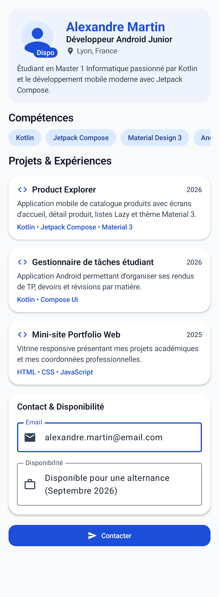
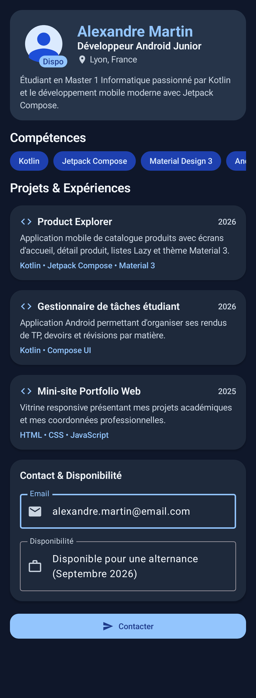

# Profil Développeur – Amélioration UI (Compose UI & Material Design 3)

## 1. Description de l'application
Cette application Android réalisée avec Jetpack Compose est l'évolution de la première fiche « Profil développeur ».  
Elle présente de manière structurée et scrollable un profil développeur complet avec des données locales : en-tête avec avatar et badge de disponibilité, liste horizontale de compétences, liste verticale de projets récents, zone de contact en lecture seule et bouton d'action principal. L'interface s'adapte automatiquement au mode clair et au mode sombre grâce à Material Design 3.

## 2. Composants Compose utilisés
- **`Text`** : affichage des titres, sous-titres, descriptions, années et technologies.
- **`Button`** : bouton principal « Contacter » exposant un callback `onClick`.
- **`Icon`** : icônes Material (`LocationOn`, `Code`, `Email`, `WorkOutline`, `Send`) pour accompagner les informations et le bouton d'action.
- **`Image`** : affichage de l'avatar développeur via `painterResource(R.drawable.ic_developer_avatar)` avec `contentDescription`.
- **`Card`** : regroupement visuel pour chaque projet (`ProjectCard`) et pour la section contact (`ContactSection`).
- **`OutlinedTextField` (en lecture seule)** : affichage structuré de l'email et de la disponibilité (`readOnly = true`, `onValueChange = {}`).

## 3. Layouts utilisés
- **`Column`** : structuration verticale à l'intérieur des cartes et sections.
- **`Row`** : alignement horizontal de l'avatar et des informations d'en-tête, des icônes avec leur texte, et du titre + année sur chaque carte projet.
- **`Box`** : superposition du badge « Dispo » dans le coin inférieur droit (`Alignment.BottomEnd`) de l'avatar dans `ProfileAvatarBox`.
- **`Spacer`** : gestion propre des espacements verticaux/horizontaux (`height`, `width`) et alignement via `weight(1f)`.
- **`Surface`** : création de zones visuelles cohérentes avec le thème (en-tête `ProfileHeaderSection`, badge de disponibilité et puces `SkillChip`).

## 4. Explication des listes affichées avec `LazyColumn` et `LazyRow`
- **`LazyColumn`** (dans `DeveloperProfileScreen`) : organise l'ensemble de l'écran en une liste verticale scrollable avec `contentPadding` et `Arrangement.spacedBy(16.dp)`. Elle combine des éléments uniques (`item` pour l'en-tête, les compétences, le contact et le bouton) et une collection dynamique (`items(items = profile.projects, key = { it.id })`) affichant chaque projet à l'aide du composable réutilisable `ProjectCard`.
- **`LazyRow`** (dans `SkillsSection`) : affiche la liste des compétences techniques sur une ligne horizontale scrollable (`Arrangement.spacedBy(8.dp)`), où chaque compétence est rendue par le composable réutilisable `SkillChip`.

## 5. Explication des choix de thème (Material Design 3)
Le thème `ProfilDeveloppeurTheme` (dans `ui/theme/Theme.kt`, `Color.kt` et `Type.kt`) centralise l'identité visuelle :
- **Couleurs (`ColorScheme`)** : une palette professionnelle bleu / gris ardoise déclinée en `LightColorScheme` et `DarkColorScheme` (sélectionnée via `isSystemInDarkTheme()`). Les rôles `primary`, `onPrimary`, `primaryContainer`, `onPrimaryContainer`, `secondary`, `background`, `onBackground`, `surface` et `onSurface` assurent un bon contraste dans les deux modes.
- **Typographie (`ProfileTypography`)** : hiérarchie claire avec `headlineMedium` pour le nom, `titleLarge` pour les titres de sections, `titleMedium` pour les titres de cartes, `bodyMedium` pour les descriptions et `labelLarge` pour les puces et boutons.
- **Formes (`ProfileShapes`)** : coins arrondis cohérents (`small` 8 dp, `medium` 14 dp, `large` 20 dp pour les cartes, `extraLarge` 28 dp pour les badges et chips).

## 6. Captures d'écran (Previews)

### Rendu Thème Clair (`DeveloperProfileLightPreview`)

### Rendu Thème Sombre (`DeveloperProfileDarkPreview`)

## 7. Quelles notions du chapitre Compose UI avez-vous réutilisées dans cette application ?
J'ai réutilisé l'ensemble des notions clés du chapitre Compose UI :
- les **composants fondamentaux** (`Text`, `Button`, `Icon`, `Image`, `Card`, `OutlinedTextField`) pour structurer les informations et l'action utilisateur ;
- les **layouts Compose** (`Column`, `Row`, `Box`, `Spacer`, `Surface`) pour organiser l'écran, aligner les éléments et superposer un badge sur l'avatar ;
- les **listes modernes** (`LazyColumn` avec `item` / `items` + `key` et `LazyRow`) associées à des **composables réutilisables** (`ProjectCard`, `SkillChip`) ;
- la **personnalisation Material Design 3** (`ColorScheme` clair et sombre, `Typography`, `Shapes`) ainsi que les **`@Preview`** light et dark pour contrôler le rendu et les contrastes.
